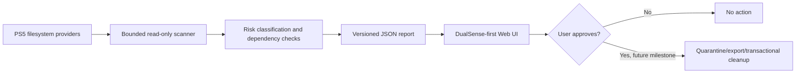

# CleanMyPS5 — architecture v0.1

## Purpose

Controller-first PS5 storage maintenance, with a strict boundary between **discovery**, **classification**, **review**, **execution** and **verification**.

### v0.2 delivered

- Offline-friendly static dashboard in `web/`, designed for TV readability, DualSense/gamepad and mouse.
- Import of a versioned JSON inventory; optional **explicit** fictional demo, never shown as real PS5 measurements.
- Portable C11/POSIX read-only inventory and embedded-asset HTTP server, limited to known roots and formats; tested on a host fixture. PS5 cross-build and on-console behavior are separate validation gates.
- Category detail, opt-in selection, protected items disabled, and selection totals.
- **No delete endpoint, no write permissions, no automatic system cleanups.**

### Runtime concurrency

The native service dispatches a maximum of four read-only workers and returns HTTP 503 rather than spawning unlimited threads. SIGINT/SIGTERM are delivered on the main accept thread, with clean draining of in-flight requests on shutdown. The host integration test opens an incomplete HTTP request and verifies that another request remains responsive.

### Implemented native read-only API

- `GET /`, `/index.html`, `/app.js`, `/styles.css`: embedded UI.
- `GET /api/status`: `target=host|ps5`, version and scanner capability.
- `GET /api/report`: bounded, read-only enumeration of known roots; includes inaccessible-path warnings. Scanner stops after ~5 seconds of monotonic scan time (checked every 64 entries) or existing hard item/visit limits; reports truncation rather than claiming exhaustive results.
- `GET /api/video?file=<encoded-path>` and `HEAD /api/video?file=...`: only captured MP4/WebM with verified signatures, symlink-immune path traversal, HTTP 206 byte ranges capped at 1 MiB/request. No unrestricted full-video GET. Decode compatibility needs physical PS5 testing.
- `GET /api/preflight`: non-destructive diagnostics of eight fixed directory paths. This reports access status, not successful runtime integration or firmware support.
- `GET /api/volumes`: opt-in `statvfs` stats for two allowlisted mount roots. Records shared-device paths instead of summing capacity. These measurements do not claim to represent PS5-wide free space.
- `GET /api/media?file=<percent-encoded-absolute-relative-path>`: on-demand JPEG/PNG originals only, served from a fixed screenshot tree via `openat` with `O_NOFOLLOW`; rejects traversal, symlinks, foreign directories, incorrect signatures, and images >32 MiB. The service is loopback only. This URL does **not** download config, saves or logs.
- `GET /api/duplicates`: explicit and bounded exact byte comparison for screenshot images. Hardlinks sharing device/inode are excluded from independently recoverable duplicates and reported as `hardlinksSkipped`. The scan also has a ~6-second soft monotonic deadline checked between file reads; slow blocking filesystem calls can overrun the deadline. No trust in equal size alone; read budget and image count limits; no file removal.
- `GET /api/diagnostics`: explicit metadata-only etaHEN/autoload inspection of 11 documented paths (two internal loaders, eight generic USB loaders, one etaHEN config); ignores commented references. App-specific autoloaders and active ShellUI injections cannot be ruled out.
- All other routes and write methods rejected; request send loops retry transient EINTR interrupts; the four-worker saturation test verifies a fifth connection receives bounded HTTP 503 and workers recover after clients disconnect; loopback binding is mandatory until authentication exists. Requests are bounded, read until a complete header, and reject non-loopback Host values, foreign Origin/Referer values and cross-site Fetch Metadata where present. This is defense-in-depth, not a substitute for native runtime validation.
- Host target must provide `--root`; the PS5 target defaults to `/`. This has **not** yet been verified on real firmware 13.60.

### Planned backend



### Trust and safety requirements

1. No recursive scan of `/` or arbitrary root as a trash folder. Restrict discovery to configured providers.
2. Never follow symlinks; do not traverse kernel/OS partitions or title/save databases.
3. Never claim files are 'junk' by extension alone. Logs, caches, DLC, updates, payloads and game data require independent rules.
4. Preserve user saves, trophies, app installation records, `/data/homebrew` and `/data/prosperoeden`.
5. Console path inventory must be versioned with source and confidence; don't silently assume FTP view equals system SSD.
6. Real cleanup later must recheck identity/mtime/size, protect against symlink races, support backups, and verify freed bytes.
7. Do not call guessed private PS5 APIs. Every native PS5 integration requires a compatible SDK and FW 13.60 runtime validation.

### Paths and evidence

| Path | Status | Meaning |
|---|---|---|
| `/data/homebrew/PPSA99008` | Previously observed via FTP | Eden Encore homebrew app, PROTECTED |
| `/data/prosperoeden` | Previously observed via FTP | Eden Encore data, PROTECTED |
| `/data/etaHEN` | Public etaHEN documentation, **not verified on this console** | configs/plugins/logs; no automated removal |
| `user/av_contents/photo/NPXS40087` | Public ProsperoGallery FW 13.60 example, **not verified on this console** | screenshot discovery candidate |
| `user/av_contents/video/NPXS40087` | Public ProsperoGallery FW 13.60 example, **not verified on this console** | clip discovery candidate |

Source references: https://github.com/AmineWallah/ProsperoGallery , https://github.com/itsPLK/ps5-pkg-manager

### Inventory schema

```json
{
  "schemaVersion": 1,
  "source": "read-only scanner",
  "scannedAt": "2026-10-21T00:00:00Z",
  "warnings": ["Any incomplete or unverified root is shown here."],
  "items": [
    {"id":"unique","category":"media","path":"/path","bytes":1048576,"risk":"review","reason":"Personal video"}
  ]
}
```

`category`: media, cache, logs, residuals, other. `risk`: review, safe, protected. No report field authorizes actual deletion.

### UI controls

- D-pad / left stick: spatial focus
- Cross: activate focused item
- Circle: back to Overview
- L1 / R1: previous/next tab
- Keyboard: arrows, Enter/Space, Escape, PageUp/PageDown, Tab
- Mouse/touch: standard focus and click

### Next milestones

1. Confirm `make ps5` cross-build in CI and validate **real** PS5 runtime, browser loopback, then add a native launcher entry with explicit consent.
2. Verify captures path, etaHEN ownership, SSD capacity measurement against **real FW 13.60**.
3. Add rich per-file preview and duplicate detection with bounded hashing, with export before deletion.
4. Transactional, opt-in cleanup only after tests on fixtures + real PS5 confirmation.
